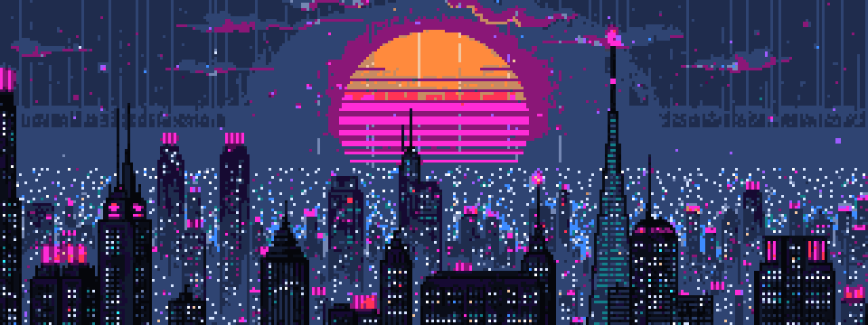
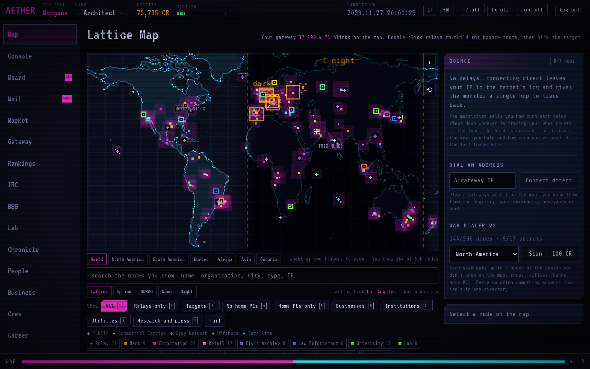
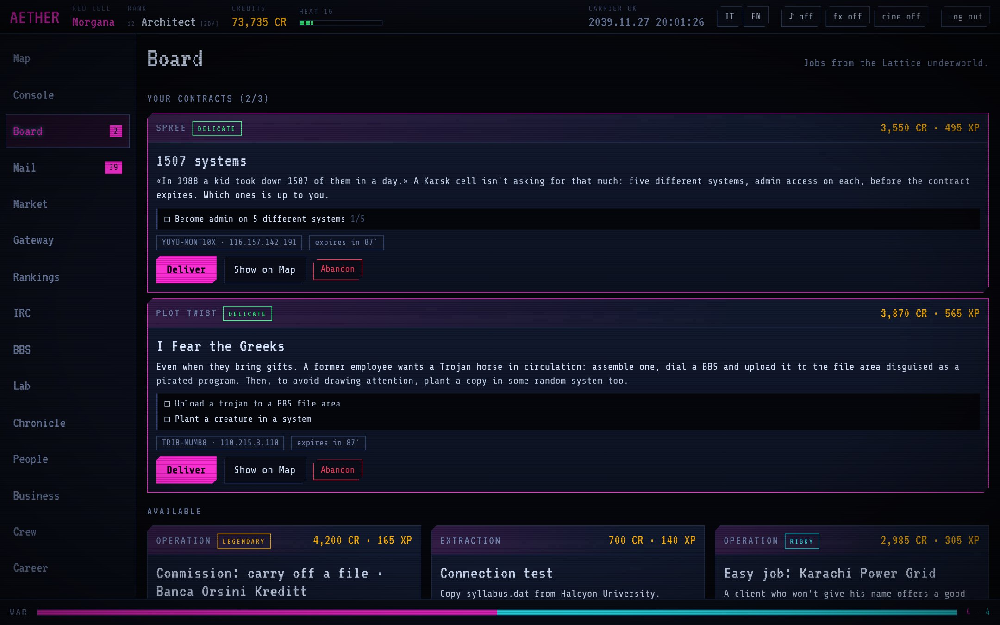
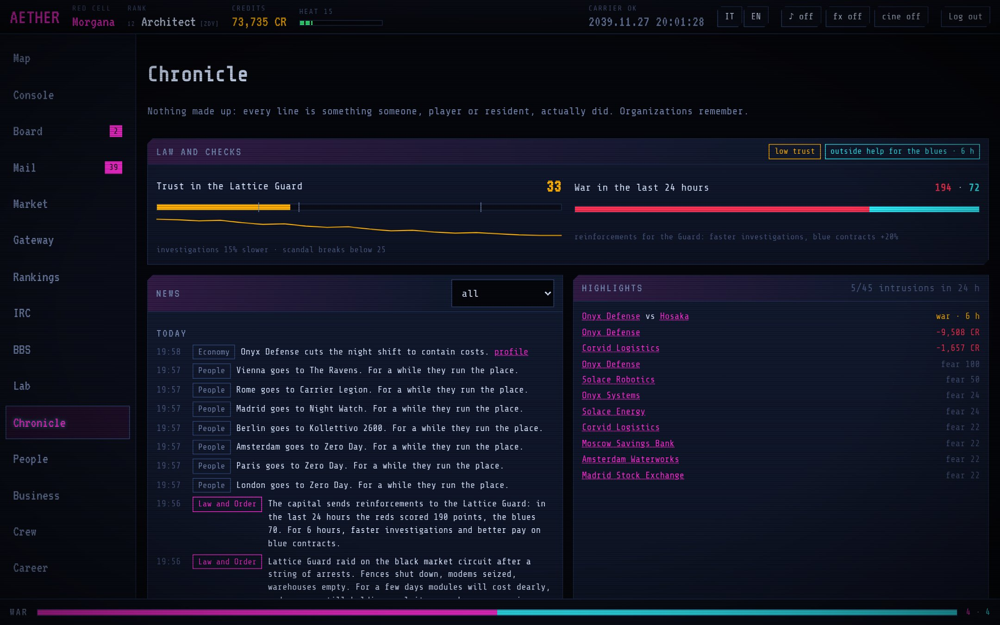
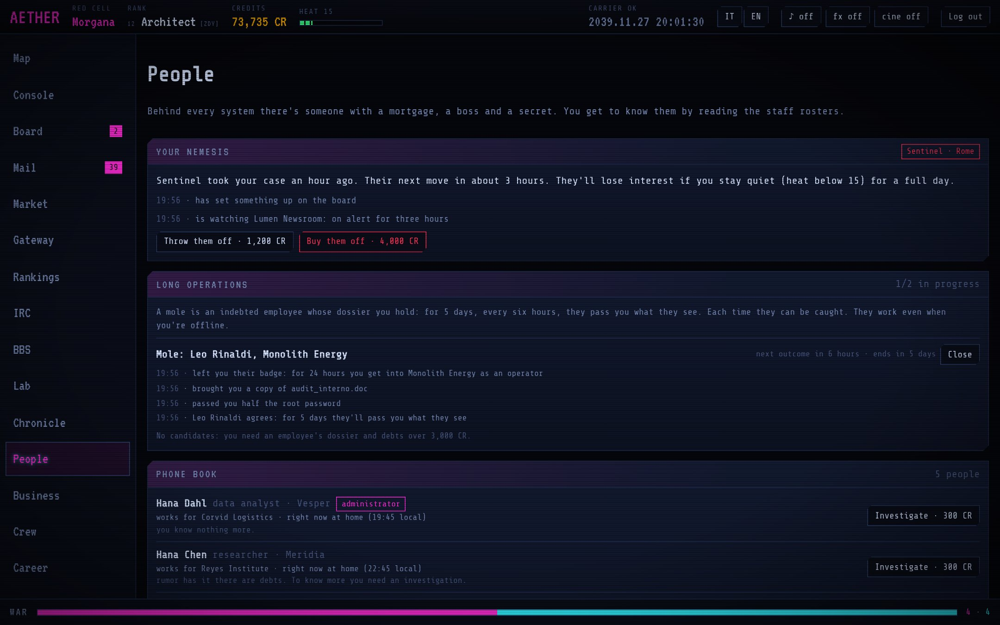

<p align="center">
  
</p>

# AETHER

**A persistent, multiplayer intrusion deck: red versus blue on the Lattice, 2039.**

[Italiano](README.md) · **English**

AETHER is a modern reimagining of *Uplink*, the 2001 hacking simulator, and a tribute to the hacker films of the '80s
and '90s: *WarGames*, *Hackers*, *Johnny Mnemonic*, *The Lawnmower Man*. You don't steer an avatar: you are a handle on
a shared network, where contracts pay, the trace burns and the logs remember everything you don't delete.


**Play in your browser:** [timrouter.dns.army/aether](https://timrouter.dns.army/aether/) · pick **EN** at the top of the
page. There is also an [Android app](https://github.com/Indr1d-C0ld/Aether/releases/latest/download/aether.apk)
(Android 7 or later, with Chrome; install it by allowing unknown sources).



## Two languages, one world

The game is played in **Italian** or **English**, and players who picked either language share the same world at the
same time. The server writes in Italian; each English client translates what it shows (interface, rules, achievements,
and everything the world writes: mail, notifications, contracts, the Chronicle, residents, BBSes) with a catalog of
about 4,500 phrases and 1,400 templates. Only IRC stays as people write it. How it works:
[DESIGN.md, «Due lingue nello stesso mondo»](DESIGN.md) (in Italian).

## How it plays

- **Reds** bounce through relays, take down proxies and firewalls, crack passwords, steal, delete, rewrite and
  sabotage, and must disconnect before the monitor traces them back to their gateway. Then they clean the logs.
- **Blues** read the logs of breached systems, follow source IPs relay after relay to the culprit, guard nodes,
  set honeypots and launch counter-traces.
- **Contracts** come from the board: extraction, sabotage, bank transfers, frame jobs, multi-stage operations,
  bounties and commissions written by other players.
- **Minigames** instead of a command line: the firewall rule grid, the Decrypter rotors, Blue Box tones, the
  oscilloscope of voice-print barriers.



## A world that keeps going without you

About 600 nodes in 73 cities, organizations with cash, fear and grudges, a hundred residents with jobs, debts and
secrets, and autonomous hackers (red and blue) who live their own day and night. Every line of the **Chronicle** is
something someone actually did. Trust in the Lattice Guard rises and falls; scandals, raids, outages that cascade from
one supplier to its clients, gangs fighting over turf, a personal nemesis on the blue side, moles and undercover
operations that run while you're offline.





Also: dial-up **BBSes** (and your own, as sysop), **ReticoloNet** IRC with bots, a virus lab with antivirus and
signatures, a stock market, crews, duels and trades, a black market and a fence, 768 achievements in 192 series.

## Quick start

Requires Node 26 or later.

```bash
git clone https://github.com/Indr1d-C0ld/Aether.git
cd Aether
npm install
npm run dev        # game server (port 7077, --watch) + Vite (port 5173)
```

Open `http://localhost:5173`. For multiplayer, open a second private window and register a handle on the other side.
Production: `npm run build && npm start` (one Node process on port 7077). Tests: `scripts/test-all.sh` (32 smoke tests,
each on a fresh world). The full documentation, rules and design notes are in Italian: [README.md](README.md),
[DESIGN.md](DESIGN.md).

## License

AETHER is free software under the [GNU General Public License v3](LICENSE). It is a tribute to *Uplink*
(Introversion Software) and contains no code or material from that game.
