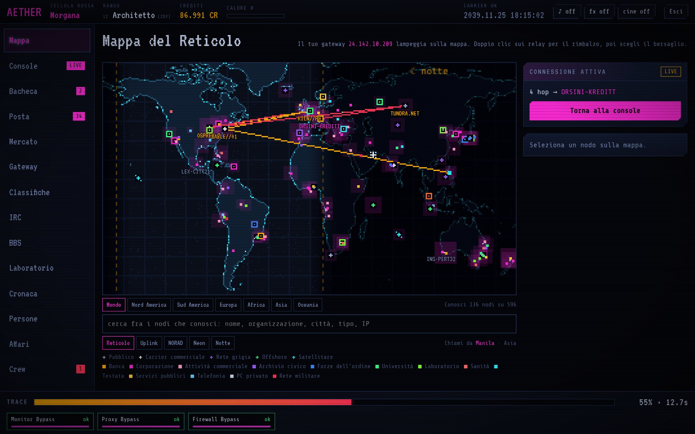
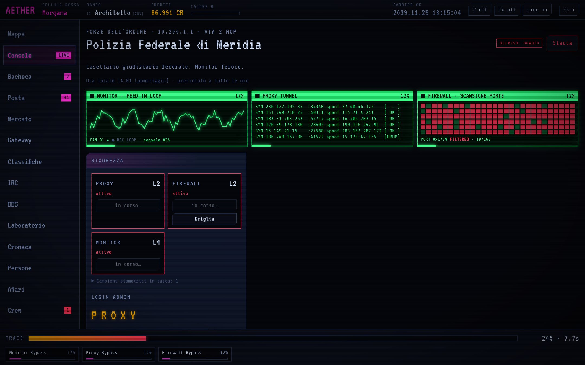
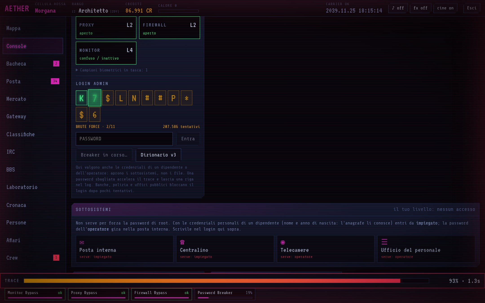
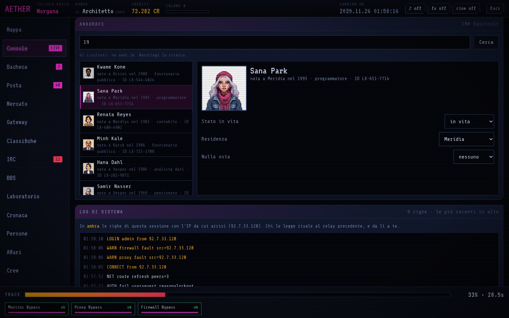
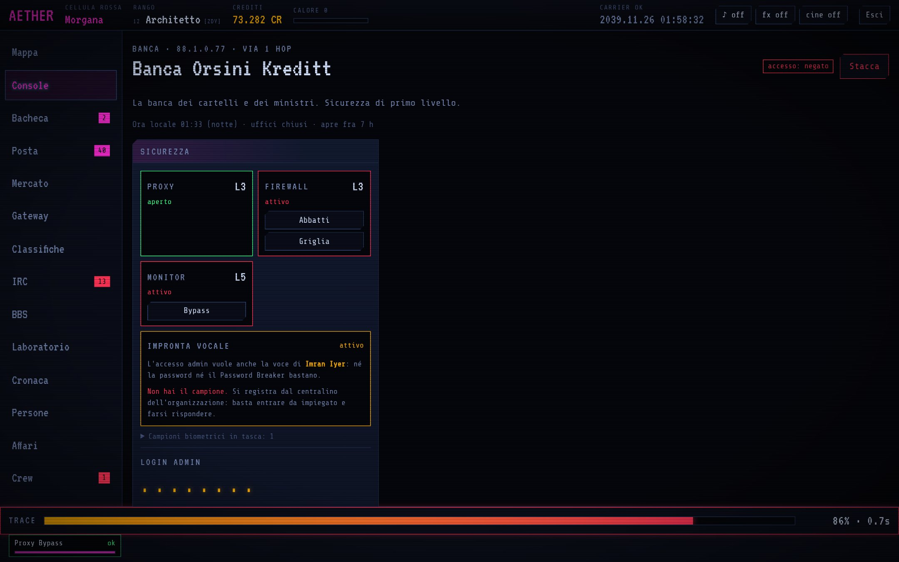

<p align="center">
  
</p>

# AETHER

**Deck d'intrusione multiplayer e persistente, rosso contro blu, sul Reticolo del 2039.**

AETHER è una reinterpretazione moderna di *Uplink*, il simulatore di hacking del 2001, e un tributo al cinema hacker
degli anni '80 e '90: *WarGames*, *Hackers*, *Johnny Mnemonic*, *Il tagliaerbe*. Non guidi un avatar: sei un handle
in una rete condivisa, dove i contratti pagano, il trace brucia e i log ricordano tutto quello che non cancelli.


## Indice

- [Come si gioca](#come-si-gioca)
- [Rossi e blu](#rossi-e-blu)
- [Il mondo](#il-mondo)
- [La regia](#la-regia)
- [Avvio rapido](#avvio-rapido)
- [Struttura](#struttura)
- [Grafica](#grafica) · [Audio](#audio) · [PWA e Android](#pwa-e-android)
- [Licenza](#licenza)

## Come si gioca

Il cuore è quello di Uplink, portato all'estremo e reso condiviso.

1. **Rimbalza.** Sul planisfero costruisci la catena di relay fra il tuo gateway e il bersaglio. Ogni hop allunga il
   trace: contano il tipo di relay, i confini attraversati, la distanza, le chiavi che possiedi e quanto hai già
   consumato quel percorso.
2. **Entra.** Abbatti proxy e firewall, confondi il monitor, forza la password. Gli strumenti lavorano in tempo reale
   e si dividono la CPU del tuo deck.
3. **Fai il lavoro.** Copia, decifra, cancella, altera un fascicolo, sposta denaro, spegni un sistema.
4. **Cancella le tracce e stacca.** Ogni azione lascia una riga nei log di ogni nodo attraversato. Quello che non
   cancelli diventa una catena di prove che qualcuno, prima o poi, seguirà fino a te.



Il server è autorevole: decide tempi, trace ed esiti. Il mondo è persistente e uno solo per tutti.

## Rossi e blu

| | Cellula rossa | Cellula blu |
|---|---|---|
| Mestiere | Intrusione, furto, sabotaggio | Difesa, forensica, caccia |
| Contratti | Rubare e distruggere dati, alterare archivi, bonifici, arresti pilotati, sabotaggi, trasporti | Recuperare file, ripristinare archivi, stornare bonifici, bonificare relay, risalire al colpevole |
| Armi | Password Breaker, bypass, Log Deleter, backdoor, exploit monouso | Forensics, Patch Kit, honeypot, sensori, analista, contro-trace |
| Rischio | Calore, capi d'accusa, mandato, arresto, cauzione | Reputazione, costi della sala operativa |

Intorno ai contratti c'è tutto il resto:

- **23 tipi di contratto** in cinque gradi di difficoltà, con modificatori e ricompense misurate.
- **Giustizia**: calore, capi d'accusa, mandati, arresto con sequestro e carcere, cauzione, fedina da ripulire nel casellario.
- **Bottino e rarità**: exploit monouso, chip da montare sul deck e quattro pezzi leggendari nascosti in nodi che non sono su nessuna mappa.
- **Mercato**: software e hardware su due canali (uno per cellula), mercato nero fra giocatori, ricettatore, taglie con deposito.
- **Gateway attaccabili**: il terminale di ogni giocatore è un nodo. Si può entrare, prosciugare, sovraccaricare, e subire la rivalsa.
- **Fama, etica, imprese e classifiche**, più una guerra permanente fra le due cellule.

<p align="center">
  
</p>

## Il mondo

Il Reticolo ha **320 nodi** su 73 città: banche, negozi, uffici pubblici, ospedali, laboratori, compagnie telefoniche,
reti elettriche, polizia, redazioni, basi militari, PC di casa. All'inizio ne conosci una trentina: gli altri si trovano
scandagliando le regioni con il War Dialer, interrogando il Registro, leggendo file e intercettando linee.

Ogni nodo reagisce secondo quello che è. Un negozio non guarda chi entra finché non tocchi la cassa. Una banca blocca
il login dopo pochi tentativi e ferma i bonifici oltre il tetto dell'antifrode. Di notte la guardia è più lenta, in
allerta più rapida, e un blackout acceca un'intera regione.

Il planisfero si può vedere in cinque stili:


Nel mondo vivono **100 cittadini** con anagrafe, fedina, titoli di studio, conto in banca, datore di lavoro e PC di casa.
Sono loro la materia dei contratti sui profili: rintracciare una persona, cambiarle i dati, farla arrestare, svuotarle il conto.


## La regia

Tutto il cinema da hacker è in scena, e si spegne con l'interruttore «cine».

Gli strumenti lavorano a schermo: oscilloscopio del monitor in loop, raffica di pacchetti falsificati, muro di porte che cade.



La password cede un carattere alla volta, mentre il brute force scorre.



Lo schedario sfoglia le foto tessera a raffica prima di fermarsi sulla scheda giusta.



E quando il trace stringe, lo schermo te lo dice.



## Avvio rapido

Serve Node 26 o successivo.

```bash
git clone https://github.com/Indr1d-C0ld/Aether.git
cd aether
npm install
npm run dev        # server di gioco (porta 7077, con --watch) + Vite (porta 5173, o PORT)
```

Apri `http://localhost:5173`. Per provare il multiplayer apri una seconda finestra in incognito
e registra un handle dell'altra cellula.

Produzione (un solo processo, client compilato servito dal server Node):

```bash
npm run build
npm start          # http://0.0.0.0:7077
```

Variabili d'ambiente: `AETHER_PORT` (default 7077), `AETHER_DB` (default `data/aether.db`).
Il server usa solo Node 26 (TypeScript nativo, `node:sqlite`) e la libreria `ws`.

Controlli:

```bash
npm run typecheck
node scripts/smoke.ts 7099          # con un server avviato su AETHER_PORT=7099: ciclo rosso + caccia blu
node scripts/smoke-gateway.ts 7099  # assalto a un gateway e rivalsa (server con AETHER_DEV=1)
node scripts/smoke-market.ts 7099   # mercato nero, ricettatore e taglie (server con AETHER_DEV=1)
node scripts/smoke-depth.ts 7099    # archivi, banca, oggetti, giustizia, War Dialer (AETHER_DEV=1 AETHER_FAST=1)
node scripts/smoke-blue.ts 7099     # lato blu completo: 7 tipi di contratto (AETHER_DEV=1 AETHER_FAST=1)
scripts/test-all.sh                 # tutti i test smoke, ognuno su un mondo pulito
node scripts/smoke-world.ts 7099    # mondo vivo: esplorazione, reazioni dei nodi, comandi di sistema (AETHER_DEV=1 AETHER_FAST=1)
node scripts/smoke-soc.ts 7099      # sala operativa blu: presidi, sensori come prova, analista (AETHER_DEV=1 AETHER_FAST=1)
node scripts/economy.ts             # economia: ricompense per grado, CR/ora, ore per salire di livello (senza server)
node scripts/playtest.ts 7099       # bilanciamento: un bot gioca a 5 livelli di equipaggiamento (AETHER_DEV=1, ~2 minuti)
```

`npm run dev` avvia il server con `AETHER_DEV=1`, che abilita l'azione di test `devGrant` (XP e crediti);
`npm start` no.

Per azzerare il mondo: ferma il server e cancella `data/aether.db*`.

## Amministrazione

Un account staff (handle in `AETHER_ADMINS`, predefinito `admin_`) ha la scheda **Admin**, la sala di controllo:

- **panoramica**: handle, connessi, attivi, iscrizioni, guerra, economia, attività degli ultimi 30 giorni, classifiche, contratti per tipo, azioni più usate, stato del mondo e del server;
- **regolazioni**: 26 manopole su economia, trace e rischio, giustizia, mondo, iscrizioni e accessi, comunicazione (ricompense, durata del trace, velocità degli strumenti, calore, arresti, NPC, bacheca, blackout, iscrizioni aperte/con approvazione/chiuse, manutenzione, avviso in alto…);
- **account**: ricerca, approvazione delle iscrizioni, sospensione a tempo o per sempre, scollegamento, cambio di chiave, rinomina, cambio di cellula, crediti/XP/calore/fama/etica, software e hardware, fedina, custodia, cancellazione; scheda con statistiche e traguardi;
- **connessioni**: chi è collegato, da dove, cosa sta facendo; indirizzi bloccati;
- **messaggi**: posta a tutti, a una cellula, ai collegati o a un singolo handle; avvisi istantanei; notizie nel feed;
- **manutenzione**: salvataggio, copia del database, bacheca rigenerata, mondo calmato, amnistia, operazioni chiuse, tutti scollegati;
- **registro**: ogni azione dell'amministrazione, con chi e quando.

L'account non si registra dal gioco: si crea (o se ne cambia la chiave) con

```bash
node scripts/admin-account.ts --db percorso/aether.db admin_
```

## Carriera e traguardi

Ogni giocatore ha la scheda **Carriera**: statistiche personali (operazioni, intrusione, dati, denaro, contratti, esplorazione,
sistemi, giustizia, difesa, mercato) e **328 traguardi**: 82 serie su ogni aspetto del gioco, ciascuna in quattro gradi
(bronzo, argento, oro, platino), più le 18 imprese speciali. Il catalogo è in `shared/achievements.ts`.

## Pubblicazione su un server

AETHER è pensato per stare dietro un reverse proxy, anche sotto un percorso:

- `AETHER_BASE=/aether/ npm run build` compila il client per quel percorso (indirizzi, WebSocket, service worker);
- `AETHER_HOST=127.0.0.1` fa ascoltare il server solo in locale, `AETHER_FLUSH_S` decide ogni quanti secondi il mondo va su disco;
- il server legge l'indirizzo vero da `X-Forwarded-For` (solo se la connessione arriva dal proxy locale) e limita
  login sbagliati (8 in 15 minuti) e registrazioni (4 all'ora) per indirizzo;
- `/health` risponde con numeri (giocatori, connessi, operazioni in corso, guerra), mai con nomi.

In `deploy/balthasar/` c'è l'installazione completa per un server Debian con Apache:
Node 26 verificato in `/opt/aether/node`, servizio systemd in sandbox, conf Apache per `/aether/` e `/aether/ws`.

```bash
sudo bash deploy/balthasar/installa.sh
```

## Struttura

Le regole e le scelte di progetto, sistema per sistema, sono in [DESIGN.md](DESIGN.md).

| Cartella | Contenuto |
|---|---|
| `shared/types.ts` | Viste inviate al client e protocollo WebSocket |
| `shared/rules.ts` | **Tutti i numeri del bilanciamento**: strumenti, hardware, trace, ranghi |
| `server/game.ts` | Simulazione autoritativa: mondo, operazioni live, trace, log, forensica, contratti, NPC |
| `server/content.ts` | Nodi, file, password, NPC del mondo iniziale, nodi nascosti |
| `server/worldgen.ts` | Generatore del mondo: circa 290 nodi di 13 tipi su 73 città, datori di lavoro e PC di casa dei cittadini |
| `server/people.ts` | I 100 cittadini (generati da un seme fisso) che popolano anagrafe, casellario, atenei e banche |
| `shared/depth.ts` | Rarità, exploit e chip, fama, etica, capi d'accusa e mandati, imprese |
| `server/db.ts` | Persistenza SQLite (documenti JSON) e account (scrypt + token) |
| `server/main.ts` | HTTP statico + WebSocket, tick a 4 Hz |
| `client/src/pixel.ts` | Pixel art procedurale: mappa 320×180, glifi, rimbalzi, skyline |
| `client/src/views/` | Accesso, deck, mappa, console d'intrusione, bacheca, mercato, ecc. |

Il client non riceve mai segreti: password, autore reale delle righe di log e honeypot altrui
restano sul server. Le azioni sono validate e temporizzate dal server; il client interpola solo
le barre (trace e task) fra un aggiornamento e l'altro.

## Grafica

Le immagini in pixel art (scena d'accesso, icone dei software e dei nodi, ritratti NPC, icona dell'app) sono generate
con PixelLab: vedi [ASSETS.md](ASSETS.md) e `scripts/pixellab.ts`. Se un file manca, il client ripiega sul disegno procedurale.

## Audio

Musica ed effetti sono sintetizzati nel browser con il Web Audio API, alla maniera delle schede FM anni '90
(AdLib / Sound Blaster): nessun file audio. `client/src/audio.ts` contiene il motore (voci FM a due operatori,
batteria sintetica, 13 effetti: modem, tastiera, allarmi, sirene, cassa…), `client/src/music.ts` il sequencer
generativo con tre brani: titolo (La minore, 86 bpm), deck (Re minore, 100 bpm) e inseguimento (Mi minore,
da 128 a 156 bpm secondo l'avanzamento del trace). Musica ed effetti si attivano separatamente dalla barra in alto;
il browser sblocca l'audio al primo clic o tasto.

## PWA e Android

Il client è una PWA (manifest + service worker, icone PNG 192 e 512). Per un APK con Bubblewrap serve
ancora un URL HTTPS pubblico del server: vedi `DESIGN.md`, sezione Prossimi passi.

## Licenza

AETHER è software libero, distribuito sotto la [GNU General Public License versione 3](LICENSE).
Puoi usarlo, studiarlo, modificarlo e ridistribuirlo alle condizioni di quella licenza; non c'è alcuna garanzia.

AETHER è un tributo a *Uplink* (Introversion Software): non contiene codice né materiale di quel gioco.
