<p align="center">
  
</p>

# AETHER

**Deck d'intrusione multiplayer e persistente, rosso contro blu, sul Reticolo del 2039.**

AETHER è una reinterpretazione moderna di *Uplink*, il simulatore di hacking del 2001, e un tributo al cinema hacker
degli anni '80 e '90: *WarGames*, *Hackers*, *Johnny Mnemonic*, *Il tagliaerbe*. Non guidi un avatar: sei un handle
in una rete condivisa, dove i contratti pagano, il trace brucia e i log ricordano tutto quello che non cancelli.


**Si gioca dal browser:** [timrouter.dns.army/aether](https://timrouter.dns.army/aether/) · novità nel [dev-log](#dev-log)

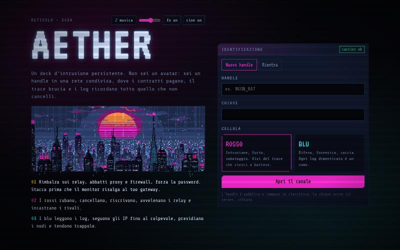

## Indice

- [Come si gioca](#come-si-gioca)
- [Rossi e blu](#rossi-e-blu)
- [Operazioni a tappe](#operazioni-a-tappe)
- [Dentro i sistemi](#dentro-i-sistemi)
- [ReticoloNet](#reticolonet)
- [Crew, duelli e scambi](#crew-duelli-e-scambi)
- [Il mondo](#il-mondo)
- [Bottino, gadget e botnet](#bottino-gadget-e-botnet)
- [Carriera e traguardi](#carriera-e-traguardi)
- [La regia](#la-regia)
- [Dev-log](#dev-log)
- [Avvio rapido](#avvio-rapido)
- [Struttura](#struttura)
- [Grafica](#grafica) · [Audio](#audio) · [PWA e Android](#pwa-e-android)
- [Licenza](#licenza)

## Come si gioca

Il cuore è quello di Uplink, portato all'estremo e reso condiviso.

1. **Rimbalza.** Sul planisfero costruisci la catena di relay fra il tuo gateway e il bersaglio. Ogni hop allunga il
   trace: contano il tipo di relay, i confini attraversati, la distanza, le chiavi che possiedi e quanto hai già
   consumato quel percorso.
2. **Entra.** Abbatti proxy e firewall, confondi il monitor, forza la password. Gli strumenti lavorano in tempo reale
   e si dividono la CPU del tuo deck.
3. **Fai il lavoro.** Copia, decifra, cancella, altera un fascicolo, sposta denaro, spegni un sistema.
4. **Cancella le tracce e stacca.** Ogni azione lascia una riga nei log di ogni nodo attraversato. Quello che non
   cancelli diventa una catena di prove che qualcuno, prima o poi, seguirà fino a te.


Il server è autorevole: decide tempi, trace ed esiti. Il mondo è persistente e uno solo per tutti.

## Rossi e blu

| | Cellula rossa | Cellula blu |
|---|---|---|
| Mestiere | Intrusione, furto, sabotaggio | Difesa, forensica, caccia |
| Contratti | Rubare e distruggere dati, alterare archivi, bonifici, arresti pilotati, sabotaggi, trasporti | Recuperare file, ripristinare archivi, stornare bonifici, bonificare relay, risalire al colpevole |
| Armi | Password Breaker, bypass, Log Deleter, backdoor, exploit monouso | Forensics, Patch Kit, honeypot, sensori, analista, contro-trace |
| Rischio | Calore, capi d'accusa, mandato, arresto, cauzione | Reputazione, costi della sala operativa |

Intorno ai contratti c'è tutto il resto:

- **27 tipi di contratto** in cinque gradi di difficoltà, fra cui 32 operazioni a tappe ispirate ai classici del cinema hacker.
- **ReticoloNet**: una rete IRC anni '90 dentro il gioco, con canali, bot, DCC per scambiarsi oggetti, crew e duelli.
- **Giustizia**: calore, capi d'accusa, mandati, arresto con sequestro e carcere, cauzione, fedina da ripulire nel casellario.
- **Bottino e rarità**: exploit monouso, gadget che si ricaricano, chip da montare sul deck e dodici pezzi leggendari nascosti in nodi che non sono su nessuna mappa.
- **Mercato**: software e hardware su due canali (uno per cellula), mercato nero fra giocatori, ricettatore, taglie con deposito.
- **Gateway attaccabili**: il terminale di ogni giocatore è un nodo. Si può entrare, prosciugare, sovraccaricare, e subire la rivalsa.
- **Fama, etica, imprese e classifiche**, più una guerra permanente fra le due cellule.

<p align="center">
  
</p>

## Operazioni a tappe

Oltre ai contratti semplici, la bacheca propone **40 operazioni** costruite sui cliché del cinema hacker e del cyberpunk.
Ognuna ha una lista di obiettivi che si spuntano mentre giochi:

- *Yippee-ki-yay*: provoca un blackout, poi svuota il caveau mentre le telecamere sono cieche;
- *Too many secrets*: intercetta una linea, entra in banca, decifra;
- *Free Kevin*, *Il cinque del nove*, *Semafori verdi*, *Il Burattinaio*, *Segnale pirata*…
- **raffiche** (cinque sistemi diversi, tre continenti, quattro tipi di nodo) e **colpi a tempo** («hai tre minuti»);
- per i blu: ispezioni a tappeto, honeynet, reti di sensori, cacce al worm.

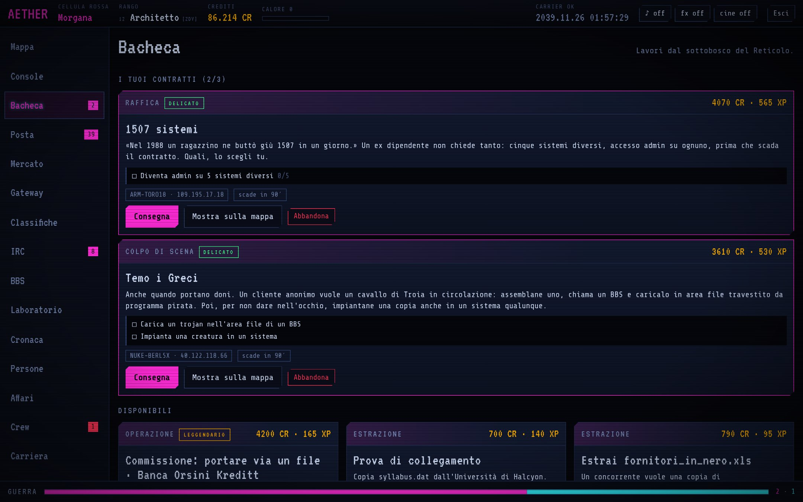

## Dentro i sistemi

Una volta collegato, un'organizzazione non è una schermata sola: ha **stanze**, ognuna con le sue azioni e il suo livello di accesso.

| Stanza | Serve | Cosa ci fai |
|---|---|---|
| Posta interna | impiegato | Leggi le caselle del personale: indirizzi, mezze password, allegati compromettenti |
| Centralino | impiegato | Sfogli la rubrica (nodi nuovi), stacchi la linea della sicurezza |
| Telecamere | operatore | Guardi la sala server, metti il nastro in loop per fermare il trace |
| Contabilità | operatore | Storni una fattura, copi il libro mastro |
| Ufficio del personale | operatore | Leggi l'organico, ti stampi un badge valido 24 ore |
| Rete interna | admin | Mappi la rete e raggiungi la macchina che da fuori non risponde |

Non serve per forza la password di root: con nome e anno di nascita di un dipendente entri da **impiegato**, e la password
dell'**operatore** gira nella posta. Dietro i sistemi più protetti ci sono 66 macchine di **rete interna**, con il bottino migliore.
I blu, dalle stesse stanze, rivedono i nastri, revocano i badge e mettono in allerta il personale.

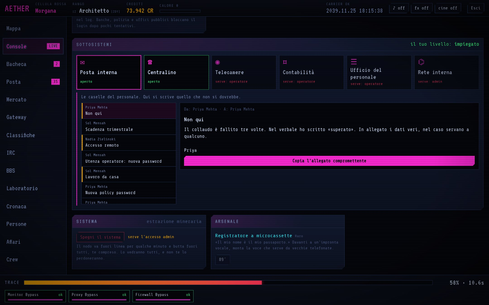

## Un mondo che vive

Il Reticolo gira sull'**ora vera**. Sulla mappa una fascia d'ombra segna dove è notte; ogni nodo ha la sua ora locale e i suoi
orari: uffici aperti dal lunedì al venerdì, negozi fino al sabato, polizia e ospedali sempre. Di giorno un impiegato che si
collega non fa notizia, di notte sì; al centralino risponde qualcuno solo quando in ufficio c'è qualcuno; in pausa pranzo i
monitor sono pigri; le casse dei negozi sono piene la sera.

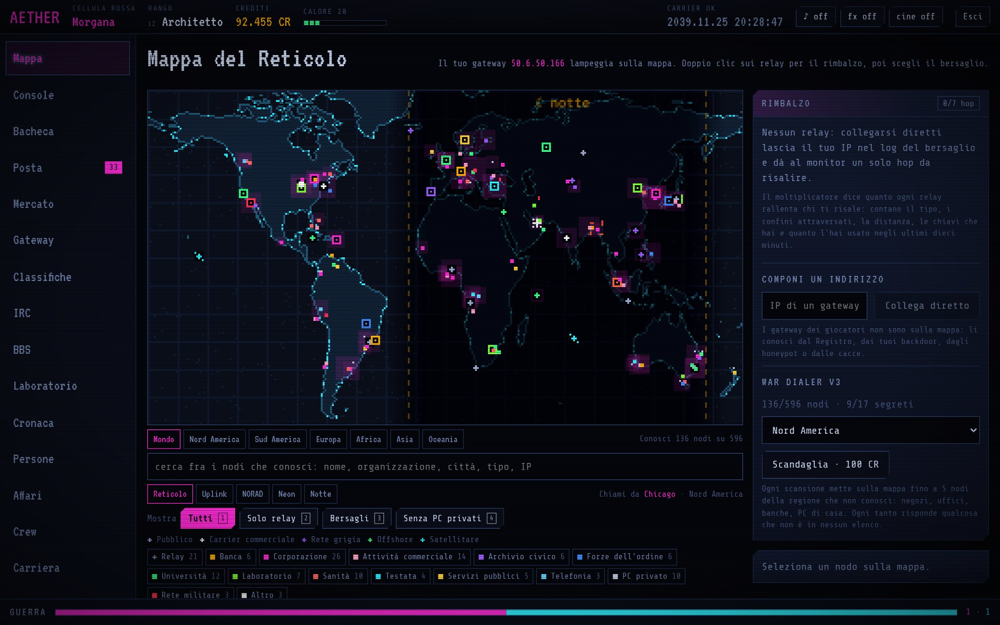

E c'è **gente**: trenta abitanti con un nome, una città e un fuso, che quando sono svegli agiscono davvero. Fanno colpi dove è
buio, mettono in giro virus, fanno la ronda, finiscono in custodia e tornano, pagano la bolletta. Poi lo raccontano in chat,
sui BBS e sui giornali.

## Sandbox

Quello che fai resta, e il mondo ci ragiona sopra.

- **Organizzazioni vive.** Ogni azienda ha una cassa, una reputazione, un morale e una paura. Derubata, compra difese migliori
  (il firewall bucato ieri oggi è un livello più su); in rosso, taglia il turno di notte; col morale a terra sciopera; in crisi,
  viene comprata dal concorrente. Chi viene colpito sospetta dei concorrenti, e alla fine scoppia una guerra commerciale con
  contratti per entrambe le cellule.
- **Cronaca.** Un giornale che riporta solo cose successe davvero, con la scheda di ogni organizzazione.
- **Persone.** I cento cittadini hanno una giornata, debiti, ferie, un lavoro che possono perdere e qualche segreto. Chi leggi
  in un organico finisce in rubrica: puoi indagare, comprare un badge, farne una fonte, ricattare. O, da blu, metterla in guardia.
- **Abitanti.** I trenta personaggi hanno ambizioni, crew, faide, e un'opinione su di te: chi ti stima ti scrive soffiate vere,
  ti fa da alibi, ti presta soldi; chi ti detesta fa il tuo nome.
- **Borsa.** Trenta titoli il cui prezzo segue lo stato vero dell'azienda. Si compra, si vende, si vende allo scoperto.
- **Copertura.** Un'attività legale intestata a te, che incassa in orario d'ufficio e attira la finanza se scotti troppo.
- **Commissioni.** Contratti scritti dai giocatori su un sistema a scelta, con condizioni che contano davvero: senza lasciare
  tracce, solo di notte o solo in orario d'ufficio (ora loro), entro mezz'ora, solo per gente esperta.
- **Il ricettatore ha un mercato.** Quello che tutti gli portano lo paga meno, quello che scarseggia lo paga di più, e ogni
  giorno cerca una merce in particolare. Contano anche i colpi degli abitanti.
- **Aziende che nascono.** Chi resta senza lavoro prima o poi apre qualcosa, con difese da principianti; quando
  un'organizzazione viene comprata, metà del personale resta a casa.
- **Soglie di mondo.** Troppe intrusioni in un giorno e scatta lo stato d'emergenza; troppi sistemi infetti in una regione e gli
  antivirus si irrigidiscono.

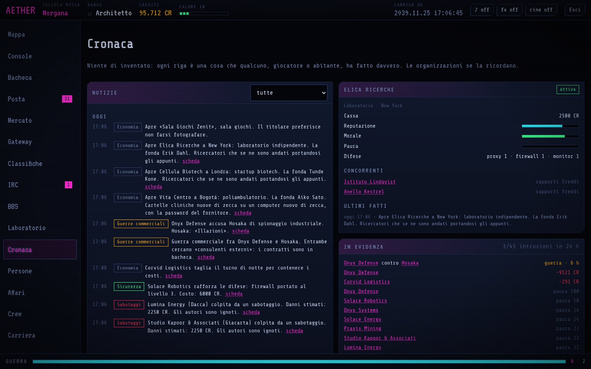

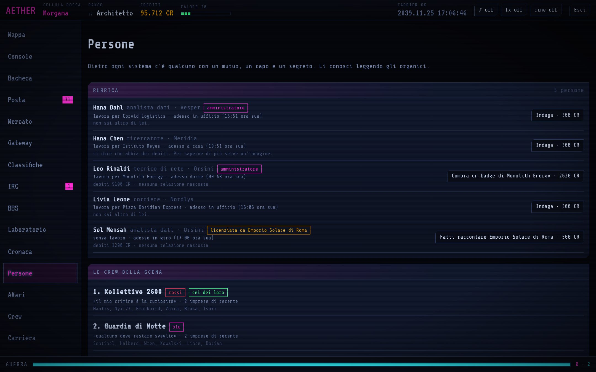

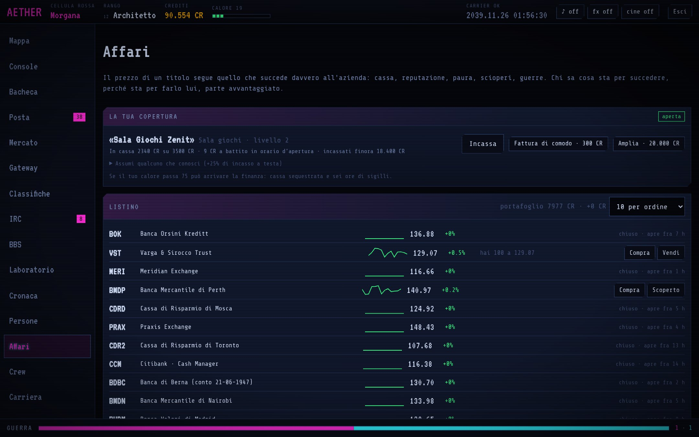

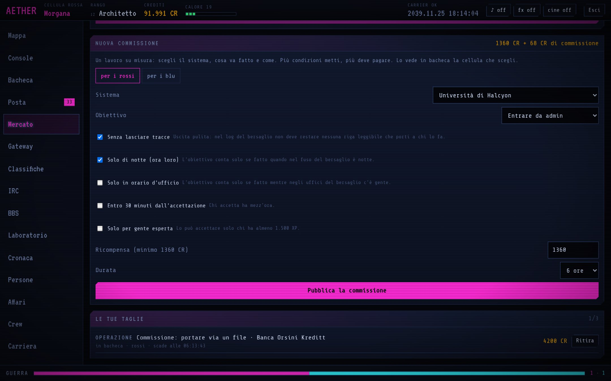

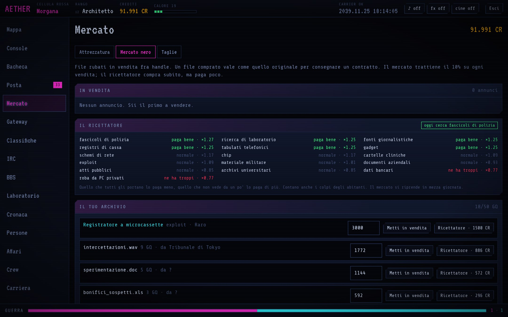

## BBS

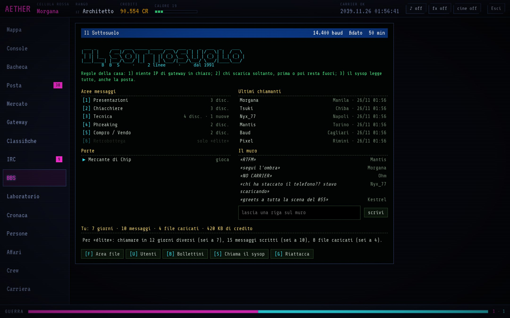

Ognuno può **aprirne uno suo**, sul proprio gateway: insegna disegnata a mano, regole, aree, area file, una porta, accesso
pubblico o su invito. Gli abitanti della sua parte lo frequentano, ci caricano file (al sysop ne resta una copia) e gli scrivono
cose vere; i visitatori ne fanno la fama. Ma troppo materiale rubato attira i sigilli della Guardia, e chi entra nel gateway del
sysop può sfregiarne l'insegna.

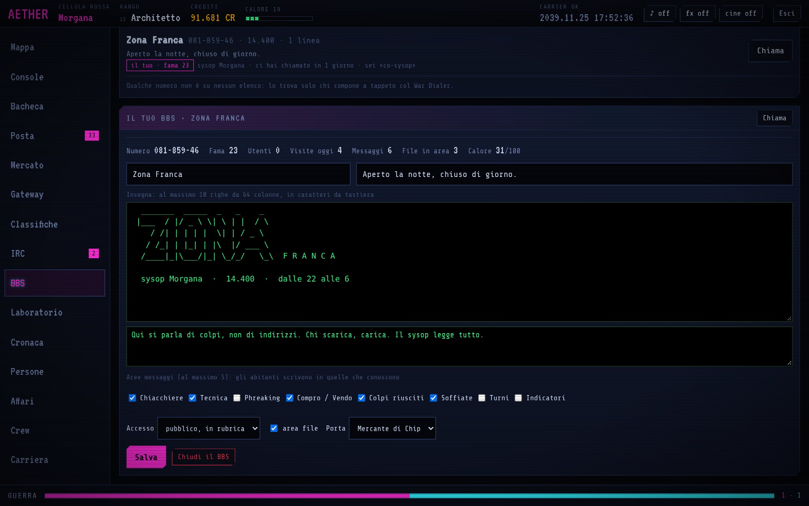

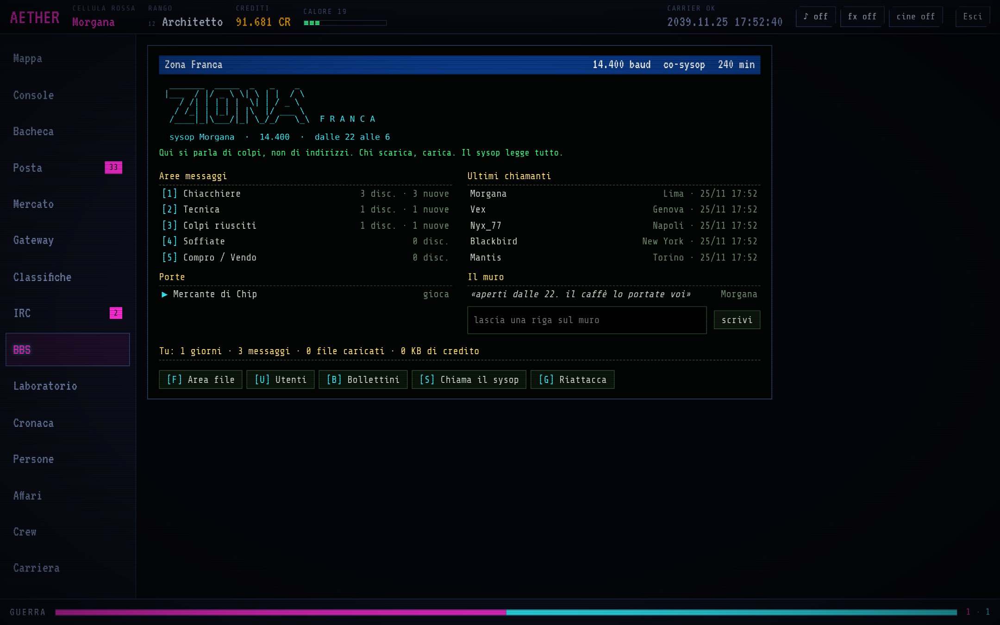

Accanto alla chat in tempo reale ci sono i **BBS**: sistemi che si chiamano col modem, uno alla volta e a tempo, dove i messaggi
restano. Ogni BBS ha le sue bacheche, i suoi **livelli d'utente** (nuovo, validato, fidato, élite) che si guadagnano chiamando,
scrivendo e caricando file, un'**area file** con il rapporto fra caricato e scaricato, il muro delle frasi, gli ultimi chiamanti e
un sysop che non è quasi mai alla tastiera. Dietro le **porte** ci sono i giochi: il Mercante di Chip, a mosse giornaliere con
classifica, e, su un numero che trova solo il War Dialer, un sistema che a tris non perde mai.

## Warez, virus e antivirus

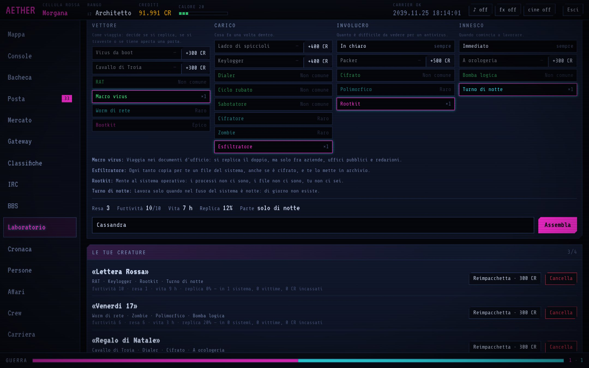

Nell'area file dei BBS girano i **warez**: programmi pirata che potenziano il deck per qualche ora, e che ogni tanto sono
infetti. Il deck si ammala (virus, dialer, RAT, bombe logiche) e si cura con un **antivirus** a tre livelli, le cui firme
invecchiano ogni giorno. Nel **Laboratorio** i rossi assemblano le proprie creature da quattro moduli (vettore, carico,
involucro, innesco), danno loro un nome e le impiantano nei sistemi o le travestono da warez; i blu scansionano, mettono in
quarantena, analizzano i campioni e **pubblicano le firme**, costringendo gli autori a reimpacchettare. È tutta finzione di
gioco: nessun codice vero, solo regole.

## Barriere biometriche

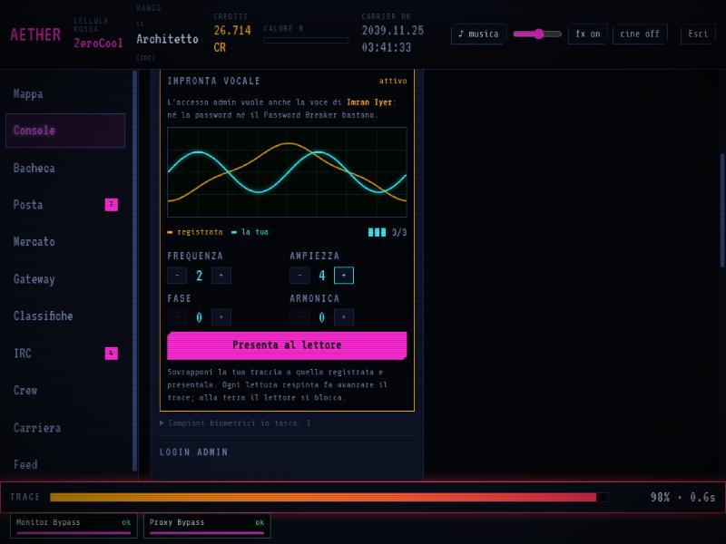

Sui sistemi più blindati (banche, basi militari, metà delle reti interne) la password di root non basta: serve anche **la voce,
l'impronta o la retina** dell'amministratore. Il campione si ruba altrove: la voce dal centralino, l'impronta dalla scheda del
badge all'ufficio del personale, la retina da una cartella clinica in ospedale. Davanti al lettore lo si accorda con
l'**oscilloscopio**: due tracce, quattro manopole, tre letture. Da admin si possono impiantare i propri modelli e rientrare
per 24 ore senza campione; i blu rispondono ri-registrando il personale.

## Minigiochi

Dove c'è una barra che avanza può esserci anche una partita, facoltativa. Il primo è la **griglia del firewall**: la tabella
delle regole, con qualche regola lasciata aperta. Ogni sonda a vuoto dice a quante caselle sta la falla più vicina; trovate
tutte, il firewall cade subito. Con almeno 2 sonde avanzate la breccia è pulita e nel log non resta una riga. Si può anche
aprire **a mano** un firewall di un livello sopra il proprio Firewall Bypass: una sonda in meno, e se finiscono il trace fa un balzo.

Il secondo sono i **rotori del Decrypter**: la chiave di un file cifrato è una fila di 3, 4 o 5 rotori. A ogni prova il sistema
dice quanti sono allineati e quanti simboli sono giusti ma fuori posto; trovata la chiave il file è in chiaro, e con almeno
2 prove avanzate il trace si ferma dieci secondi. Anche qui si può andare a mano un livello sopra il proprio Decrypter.

Il terzo sono i **toni della Blue Box**: mentre il War Dialer compone, un fischio a 2600 Hz apre la linea e il centralino suona
una sequenza di toni DTMF da ripetere sul tastierino, per tre giri sempre più lunghi. Chi li azzecca chiude subito la scansione
con 2 nodi in più e più probabilità di trovare un nodo segreto; chi sbaglia paga 300 CR di interurbana.

## ReticoloNet

Dentro il deck c'è una rete IRC come quelle del 1996: è lì che i giocatori si parlano, trattano e si sfidano.

- Canali pubblici (`#reticolo`, `#mercato`, `#2600`, `#warez`, `#cyberia`), di cellula (`#rossi`, `#blu`), di crew, e un paio che non compaiono in `/list`.
- Query private, operatori di canale, topic, `/whois`, `/away`, `/ignore`, CTCP, MOTD in ASCII, netsplit.
- Bot: l'**Oracolo** distribuisce voci di corridoio (`!voce`), e ogni tanto il numero di un nodo che non è su nessun elenco;
  **Lumen** rilancia le notizie del mondo; **XDCC-Kestrel** regala un pacchetto al giorno; gli handle NPC chiacchierano.
- La chat è parte del gioco: `/paga nick importo`, `/dcc send nick n [prezzo]` per passare file, exploit, chip e gadget,
  `/sfida nick posta`, `/crew …`.

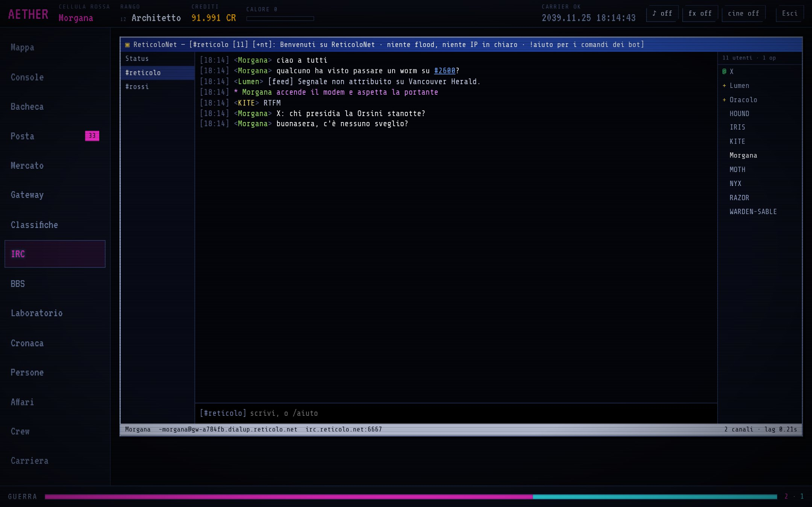

## Crew, duelli e scambi

- **Crew**: fino a 12 handle della stessa cellula, con un canale privato, una cassa comune e un posto in classifica.
- **Duelli**: stessa posta, un bersaglio a sorte uguale per tutti e due, dieci minuti. Chi buca per primo prende il piatto.
- **Scambi**: qualunque oggetto passa di mano, a un prezzo o in regalo; i crediti si mandano con una commissione del 5%.

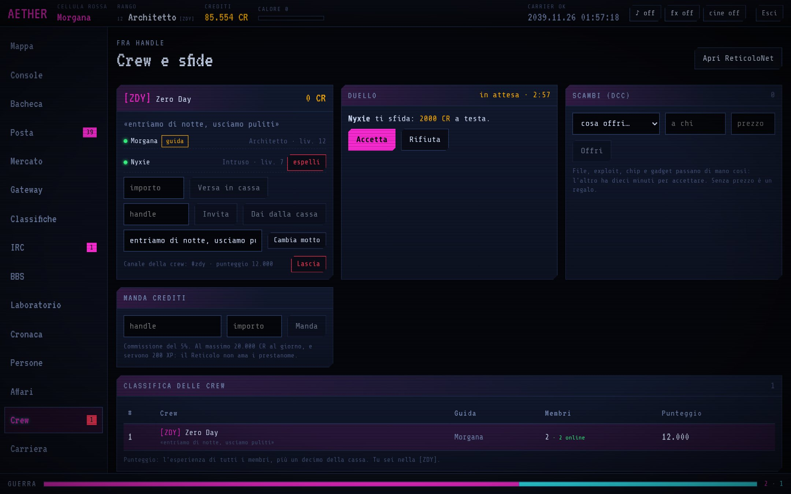

## Il mondo

Il Reticolo ha **oltre 590 nodi** su 73 città: banche, negozi, uffici pubblici, ospedali, laboratori, compagnie telefoniche,
reti elettriche, polizia, redazioni, basi militari, PC di casa. All'inizio ne conosci una trentina: gli altri si trovano
scandagliando le regioni con il War Dialer, interrogando il Registro, leggendo file e intercettando linee.

Ogni nodo reagisce secondo quello che è. Un negozio non guarda chi entra finché non tocchi la cassa. Una banca blocca
il login dopo pochi tentativi e ferma i bonifici oltre il tetto dell'antifrode. Di notte la guardia è più lenta, in
allerta più rapida, e un blackout acceca un'intera regione.

Il planisfero si può vedere in cinque stili:

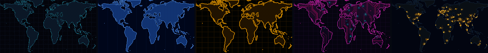

Molte insegne le riconoscerà chi ha visto i film giusti e letto i romanzi giusti, e **17 nodi segreti** non compaiono su
nessuna mappa: una villa in orbita, una fabbrica di giocattoli con troppe guardie, un computer che ha imparato una canzone
a Urbana. Si trovano col War Dialer, o con una soffiata su ReticoloNet.

Nel mondo vivono **100 cittadini** con anagrafe, fedina, titoli di studio, conto in banca, datore di lavoro e PC di casa.
Sono loro la materia dei contratti sui profili: rintracciare una persona, cambiarle i dati, farla arrestare, svuotarle il conto.


## Bottino, gadget e botnet

- **Exploit** monouso (22): 0-day, chiavi scheletro, rompighiaccio, bustarelle, la parola di un fixer.
- **Gadget** (8): non si consumano, si ricaricano. Blue Box, Walkman, Tastiera Model M, Macchina Esper…
- **Chip** per il deck, con dieci tipi di effetto e cinque rarità; fino a sei slot.
- **Leggendari** (12): pezzi unici nascosti nei nodi segreti.
- **Worm**: uno strumento rosso. Piantato in un sistema rende spiccioli ogni 45 secondi per un'ora, finché un blu
  con il Patch Kit non lo schiaccia. Più worm, più botnet.

## Carriera e traguardi

Venti ranghi, livelli da 1 a 99 e sette **specializzazioni** (intrusione, furtività, dati, finanza, sabotaggio, esplorazione,
difesa) che crescono con quello che fai davvero e danno fino al 10% nel loro campo. La scheda **Carriera** tiene le
statistiche personali e **664 traguardi**: 166 serie in quattro gradi (bronzo, argento, oro, platino), più 18 imprese speciali.

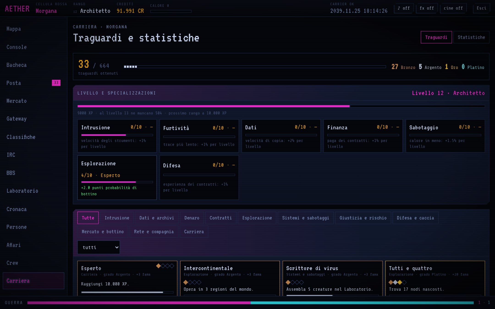

## La regia

Tutto il cinema da hacker è in scena, e si spegne con l'interruttore «cine».

Gli strumenti lavorano a schermo: oscilloscopio del monitor in loop, raffica di pacchetti falsificati, muro di porte che cade.


La password cede un carattere alla volta, mentre il brute force scorre.


Lo schedario sfoglia le foto tessera a raffica prima di fermarsi sulla scheda giusta.


E quando il trace stringe, lo schermo te lo dice.


## Dev-log

Le novità sono raccontate ai giocatori sulla pagina d'ingresso e nel deck; il testo sta in [`shared/devlog.ts`](shared/devlog.ts)
e si aggiorna a ogni modifica.

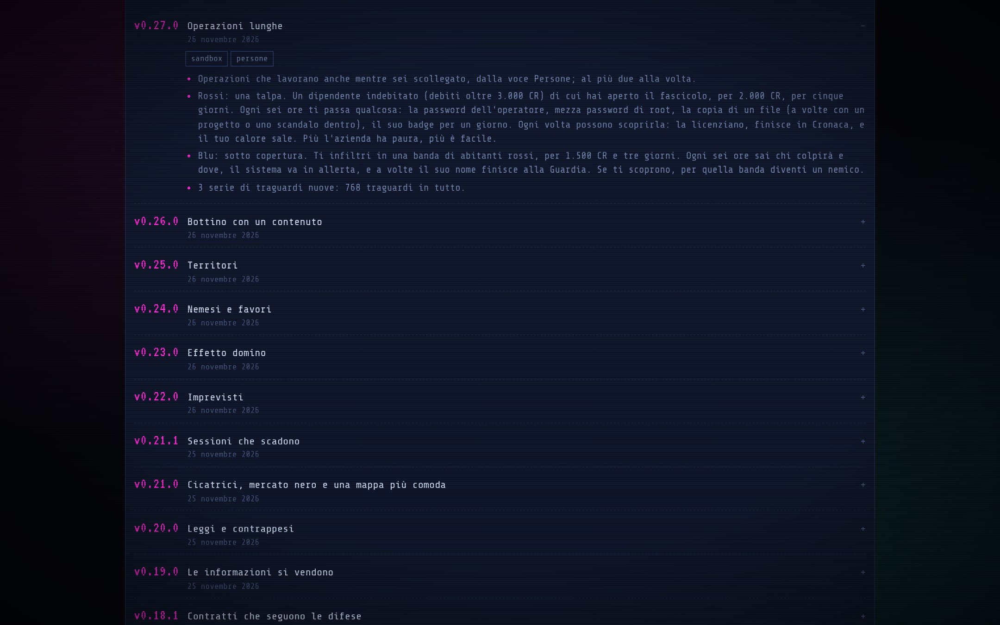

| Versione | Data | Novità |
|---|---|---|
| 0.18.1 | 25 novembre 2026 | Contratti ripagati quando il bersaglio si rafforza; tutte le immagini rifatte |
| 0.18.0 | 25 novembre 2026 | Il BBS del giocatore: insegna, aree, area file, fama, sequestri e sfregi |
| 0.17.0 | 25 novembre 2026 | Commissioni con condizioni, mercato del ricettatore, aziende che nascono |
| 0.16.0 | 25 novembre 2026 | Sandbox: la copertura del giocatore |
| 0.15.0 | 25 novembre 2026 | Sandbox: la Borsa del Reticolo |
| 0.14.0 | 25 novembre 2026 | Sandbox: abitanti con ambizioni, amicizie, crew e faide |
| 0.13.0 | 25 novembre 2026 | Sandbox: persone con routine, debiti e segreti |
| 0.12.0 | 25 novembre 2026 | Sandbox: organizzazioni vive, Cronaca, eventi di mondo |
| 0.11.0 | 25 novembre 2026 | Giorno e notte sull'ora vera, orari d'ufficio, trenta abitanti che agiscono da soli |
| 0.10.0 | 25 novembre 2026 | Warez, laboratorio di malware, antivirus e firme |
| 0.9.0 | 25 novembre 2026 | BBS: bacheche, livelli, area file, porte, e un sistema che vuole giocare |
| 0.8.0 | 25 novembre 2026 | Barriere biometriche, oscilloscopio, campioni da rubare |
| 0.7.0 | 25 novembre 2026 | I toni della Blue Box, il terzo minigioco |
| 0.6.0 | 25 novembre 2026 | I rotori del Decrypter, il secondo minigioco |
| 0.5.0 | 25 novembre 2026 | La griglia del firewall, il primo minigioco |
| 0.4.0 | 24 novembre 2026 | Sottosistemi, tre livelli di accesso, posta interna, reti interne |
| 0.3.0 | 24 novembre 2026 | ReticoloNet, crew, duelli, operazioni a tappe, gadget, worm, 527 nodi, 20 ranghi |
| 0.2.0 | 18 novembre 2026 | Carriera, traguardi, sala di controllo dell'amministrazione |
| 0.1.2 | 18 novembre 2026 | Pubblicazione in rete |
| 0.1.1 | 18 novembre 2026 | Regia cinematografica, mondo aperto ribilanciato |
| 0.1.0 | 17 novembre 2026 | Prima versione |

## Avvio rapido

Serve Node 26 o successivo.

```bash
git clone https://github.com/Indr1d-C0ld/Aether.git
cd aether
npm install
npm run dev        # server di gioco (porta 7077, con --watch) + Vite (porta 5173, o PORT)
```

Apri `http://localhost:5173`. Per provare il multiplayer apri una seconda finestra in incognito
e registra un handle dell'altra cellula.

Produzione (un solo processo, client compilato servito dal server Node):

```bash
npm run build
npm start          # http://0.0.0.0:7077
```

Variabili d'ambiente: `AETHER_PORT` (default 7077), `AETHER_DB` (default `data/aether.db`).
Il server usa solo Node 26 (TypeScript nativo, `node:sqlite`) e la libreria `ws`.

Controlli:

```bash
npm run typecheck
node scripts/smoke.ts 7099          # con un server avviato su AETHER_PORT=7099: ciclo rosso + caccia blu
node scripts/smoke-gateway.ts 7099  # assalto a un gateway e rivalsa (server con AETHER_DEV=1)
node scripts/smoke-market.ts 7099   # mercato nero, ricettatore e taglie (server con AETHER_DEV=1)
node scripts/smoke-depth.ts 7099    # archivi, banca, oggetti, giustizia, War Dialer (AETHER_DEV=1 AETHER_FAST=1)
node scripts/smoke-blue.ts 7099     # lato blu completo: 7 tipi di contratto (AETHER_DEV=1 AETHER_FAST=1)
scripts/test-all.sh                 # tutti i test smoke (9), ognuno su un mondo pulito
node scripts/smoke-world.ts 7099    # mondo vivo: esplorazione, reazioni dei nodi, comandi di sistema (AETHER_DEV=1 AETHER_FAST=1)
node scripts/smoke-soc.ts 7099      # sala operativa blu: presidi, sensori come prova, analista (AETHER_DEV=1 AETHER_FAST=1)
node scripts/economy.ts             # economia: ricompense per grado, CR/ora, ore per salire di livello (senza server)
node scripts/playtest.ts 7099       # bilanciamento: un bot gioca a 5 livelli di equipaggiamento (AETHER_DEV=1, ~2 minuti)
```

`npm run dev` avvia il server con `AETHER_DEV=1`, che abilita l'azione di test `devGrant` (XP e crediti);
`npm start` no.

Per azzerare il mondo: ferma il server e cancella `data/aether.db*`.

## Amministrazione

Un account staff (handle in `AETHER_ADMINS`, predefinito `admin`) ha la scheda **Admin**, la sala di controllo:

- **panoramica**: handle, connessi, attivi, iscrizioni, guerra, economia, attività degli ultimi 30 giorni, classifiche, contratti per tipo, azioni più usate, stato del mondo e del server;
- **regolazioni**: 27 manopole su economia, trace e rischio, giustizia, mondo, iscrizioni e accessi, comunicazione (ricompense, durata del trace, velocità degli strumenti, calore, arresti, NPC, bacheca, blackout, iscrizioni aperte/con approvazione/chiuse, manutenzione, avviso in alto…);
- **account**: ricerca, approvazione delle iscrizioni, sospensione a tempo o per sempre, scollegamento, cambio di chiave, rinomina, cambio di cellula, crediti/XP/calore/fama/etica, software e hardware, fedina, custodia, cancellazione; scheda con statistiche e traguardi;
- **connessioni**: chi è collegato, da dove, cosa sta facendo; indirizzi bloccati;
- **messaggi**: posta a tutti, a una cellula, ai collegati o a un singolo handle; avvisi istantanei; notizie nel feed;
- **manutenzione**: salvataggio, copia del database, bacheca rigenerata, mondo calmato, amnistia, operazioni chiuse, tutti scollegati;
- **registro**: ogni azione dell'amministrazione, con chi e quando.

L'account non si registra dal gioco: si crea (o se ne cambia la chiave) con

```bash
node scripts/admin-account.ts --db percorso/aether.db admin
```

## Pubblicazione su un server

AETHER è pensato per stare dietro un reverse proxy, anche sotto un percorso:

- `AETHER_BASE=/aether/ npm run build` compila il client per quel percorso (indirizzi, WebSocket, service worker);
- `AETHER_HOST=127.0.0.1` fa ascoltare il server solo in locale, `AETHER_FLUSH_S` decide ogni quanti secondi il mondo va su disco;
- il server legge l'indirizzo vero da `X-Forwarded-For` (solo se la connessione arriva dal proxy locale) e limita
  login sbagliati (8 in 15 minuti) e registrazioni (4 all'ora) per indirizzo;
- `/health` risponde con numeri (giocatori, connessi, operazioni in corso, guerra), mai con nomi.

In `deploy/balthasar/` c'è l'installazione completa per un server Debian con Apache:
Node 26 verificato in `/opt/aether/node`, servizio systemd in sandbox, conf Apache per `/aether/` e `/aether/ws`.

```bash
sudo bash deploy/balthasar/installa.sh
```

## Struttura

Le regole e le scelte di progetto, sistema per sistema, sono in [DESIGN.md](DESIGN.md).

| Cartella | Contenuto |
|---|---|
| `shared/types.ts` | Viste inviate al client e protocollo WebSocket |
| `shared/rules.ts` | **Tutti i numeri del bilanciamento**: strumenti, hardware, trace, ranghi |
| `server/game.ts` | Simulazione autoritativa: mondo, operazioni live, trace, log, forensica, contratti, NPC |
| `server/content.ts` | Nodi, file, password, NPC del mondo iniziale, nodi nascosti |
| `server/scenarios.ts` | I copioni delle operazioni a tappe |
| `server/orgs.ts`, `server/citizens.ts`, `server/stocks.ts`, `server/fronts.ts` | Sandbox: organizzazioni e cronaca, persone, Borsa, coperture |
| `server/life.ts`, `server/life-text.ts`, `shared/clock.ts` | Orologio del mondo, regole di giorno e di notte, popolazione autonoma e i suoi testi |
| `server/malware.ts`, `shared/malware.ts`, `client/src/views/Lab.tsx` | Warez, infezioni del deck, laboratorio, antivirus e firme |
| `server/bbs.ts`, `server/bbs-text.ts`, `shared/bbs.ts`, `client/src/views/Bbs.tsx` | I BBS: stato, testi, tipi, interfaccia |
| `server/bio.ts`, `shared/bio.ts`, `client/src/views/Scope.tsx` | Barriere biometriche, campioni, oscilloscopio |
| `shared/tones.ts`, `client/src/views/Tones.tsx` | I toni della Blue Box |
| `shared/rotors.ts`, `client/src/views/Rotors.tsx` | I rotori del Decrypter |
| `shared/grid.ts`, `client/src/views/FirewallGrid.tsx` | La griglia del firewall (la logica sta in `server/game.ts`, il segreto non lascia il server) |
| `server/zones.ts`, `shared/zones.ts` | Sottosistemi dei nodi, credenziali del personale, posta interna, reti interne |
| `server/social.ts` | Crew, duelli, scambi e crediti fra giocatori |
| `server/irc.ts`, `server/irc-text.ts` | ReticoloNet: canali, comandi, bot; MOTD, chiacchiere e voci di corridoio |
| `server/admin.ts` | Il pannello dell'amministratore |
| `shared/achievements.ts`, `shared/progress.ts` | Traguardi; specializzazioni |
| `shared/devlog.ts` | Le novità mostrate ai giocatori |
| `server/worldgen.ts` | Generatore del mondo: circa 490 nodi di 13 tipi su 73 città, datori di lavoro e PC di casa dei cittadini |
| `server/people.ts` | I 100 cittadini (generati da un seme fisso) che popolano anagrafe, casellario, atenei e banche |
| `shared/depth.ts` | Rarità, exploit e chip, fama, etica, capi d'accusa e mandati, imprese |
| `server/db.ts` | Persistenza SQLite (documenti JSON) e account (scrypt + token) |
| `server/main.ts` | HTTP statico + WebSocket, tick a 4 Hz |
| `client/src/pixel.ts` | Pixel art procedurale: mappa 320×180, glifi, rimbalzi, skyline |
| `client/src/views/` | Accesso, deck, mappa, console d'intrusione, bacheca, mercato, ecc. |

Il client non riceve mai segreti: password, autore reale delle righe di log e honeypot altrui
restano sul server. Le azioni sono validate e temporizzate dal server; il client interpola solo
le barre (trace e task) fra un aggiornamento e l'altro.

## Grafica

Le immagini in pixel art (scena d'accesso, icone dei software e dei nodi, ritratti NPC, icona dell'app) sono generate
con PixelLab: vedi [ASSETS.md](ASSETS.md) e `scripts/pixellab.ts`. Se un file manca, il client ripiega sul disegno procedurale.


Le schermate del README si rifanno con `scripts/showcase.ts`: prepara un mondo di prova pieno di cose (nodi scoperti, cronaca,
persone, creature, copertura, Borsa, una commissione) e le fotografa con Chromium senza finestra, a 2160×1350.
## Audio

Musica ed effetti sono sintetizzati nel browser con il Web Audio API, alla maniera delle schede FM anni '90
(AdLib / Sound Blaster): nessun file audio. `client/src/audio.ts` contiene il motore (voci FM a due operatori,
batteria sintetica, 13 effetti: modem, tastiera, allarmi, sirene, cassa…), `client/src/music.ts` il sequencer
generativo con tre brani: titolo (La minore, 86 bpm), deck (Re minore, 100 bpm) e inseguimento (Mi minore,
da 128 a 156 bpm secondo l'avanzamento del trace). Musica ed effetti si attivano separatamente dalla barra in alto;
il browser sblocca l'audio al primo clic o tasto.

## PWA e Android

Il client è una PWA (manifest + service worker, icone PNG 192 e 512). Per un APK con Bubblewrap serve
ancora un URL HTTPS pubblico del server: vedi `DESIGN.md`, sezione Prossimi passi.

## Licenza

AETHER è software libero, distribuito sotto la [GNU General Public License versione 3](LICENSE).
Puoi usarlo, studiarlo, modificarlo e ridistribuirlo alle condizioni di quella licenza; non c'è alcuna garanzia.

AETHER è un tributo a *Uplink* (Introversion Software): non contiene codice né materiale di quel gioco.
